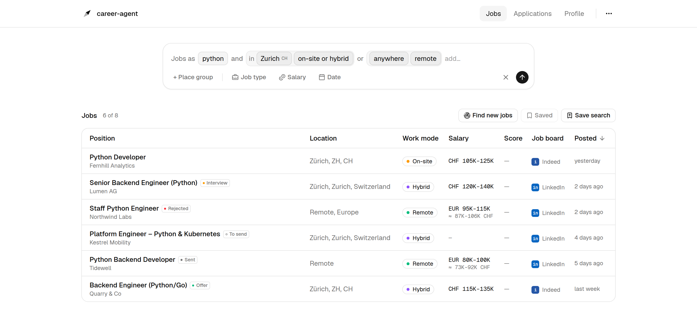
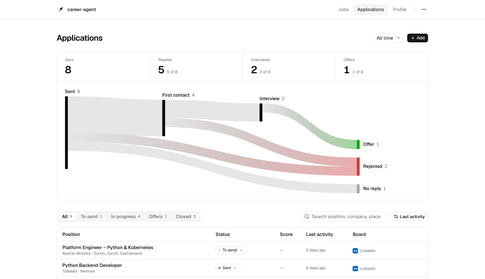

# career-agent

**Search once and get a CV written for every job, checked against what you actually did.**



career-agent runs on your computer. It searches LinkedIn and Indeed, scores each posting against your profile and
writes a CV for it in one of seven print-ready templates. Then it follows the application from *sent* to *offer*.
The AI is the CLI you already pay for (Claude Code or Codex), run headless and without tools. There are no API keys
and no account, and nothing leaves the machine except the searches themselves.

## What's different

**The search bar takes a sentence.** Type `python developer, Zurich hybrid or remote anywhere, 100k, last week` and
it becomes filters you can click to edit: title, place groups, work mode, salary in any currency, date. It reads 13
languages, so `Teilzeit`, `télétravail`, `정규직` and `연봉 1억` all work. The whole query lives in the URL.

**The AI can't make you up.** A tailored CV is assembled by the server, not written by the model. The model only
returns what tailoring may change: bullet order, wording in the posting's vocabulary, the summary, which projects
make the cut. Every rewrite is compared with your profile. If it brings in a number, a tool, an employer or a
seniority that isn't there, it goes back to your own words. The CV lists every change it undid, so you can see
what the model tried.

**The score shows its working.** The fit score lists the posting's requirements and how much each matters. For
each one it gives the line of your profile that covers it, or the gap to prepare for the interview. A quote that
isn't in the posting is dropped, and a dimension with no evidence doesn't count instead of becoming a neutral 3.
If the posting states one of your dealbreakers, the advice is to skip, even with a high score.

**It browses the boards like you would.** Results come live from LinkedIn and Indeed, most relevant or most
recent, as the boards' own buttons sort them. **Show more** loads the next page of each search. A search costs one
request per page; a posting's own page is read only when you open it, and only what you open is stored.

**It doesn't get you banned.** Requests to a board are 3–7 seconds apart. LinkedIn gets at most 70 requests an hour
and 150 a day, Indeed 100 a day. A page read in the last hour (newest first) or three hours (by relevance) comes
from memory, not the board. At the first sign of throttling, that board is left alone for 45 minutes, then 6 and
24 hours if it happens again within a day, and the pause holds across a restart.

**Applications keep the posting.** Each application keeps a copy of the posting's text, taken when you add it, so
you can still prepare for the interview after the ad is gone. Above the list, a Sankey chart shows where your
applications go: click any band to filter the list to it.



## Quick start

Requires Python 3.12+, [uv](https://docs.astral.sh/uv/), Node.js 20+. For the AI features, sign in to
[Claude Code](https://claude.com/claude-code) or [Codex](https://github.com/openai/codex). For PDF export, any
Chromium-based browser.

```bash
cd web && npm install && npm run build && cd ..
uv run career-agent          # http://127.0.0.1:8000
```

`HOST=0.0.0.0` opens it to your network, and there is no login. Everything is stored in `./data`, a SQLite
database plus your uploads.

## The pieces

| | |
|---|---|
| **Search** | LinkedIn and Indeed through [JobSpy](https://github.com/speedyapply/JobSpy). Work mode is inferred from the text, because LinkedIn ignores its own filter. Salaries are converted with the day's ECB rates. |
| **Profile** | Import a PDF or paste text. Each entry must quote the CV word for word, or it's flagged for you to review. An AI review suggests rewrites, and asks you for numbers instead of inventing them. |
| **CV** | The templates are [career-ops](https://github.com/career-ops-hq/career-ops)', unchanged. The PDF is printed by a local headless browser, with networking off. Per posting you can override the language, paper size, photo, footer and guidance. |
| **Languages** | The interface and CVs come in English, Italian, German, Spanish, French, Portuguese, Dutch, Turkish, Russian, Indonesian, Chinese, Japanese and Korean. |

How each part works, with its limits and the full API: [docs/reference.md](docs/reference.md). The UI:
[web/README.md](web/README.md).

## Development

```bash
uv run career-agent      # API + built UI on :8000
cd web && npm run dev    # hot reload on :5173, proxies /api
uv run pytest && (cd web && npm test && npx tsc -b && npm run lint)
```

The tests never reach the boards, the geocoder, the ECB or an AI CLI. Each test gets its own database.

## Credits

CV templates and the evaluation method come from [career-ops](https://github.com/career-ops-hq/career-ops) (MIT).
Board access is [JobSpy](https://github.com/speedyapply/JobSpy), place names are
[Open-Meteo](https://open-meteo.com/en/docs/geocoding-api) / GeoNames, and the UI is built with
[shadcn/ui](https://ui.shadcn.com).
